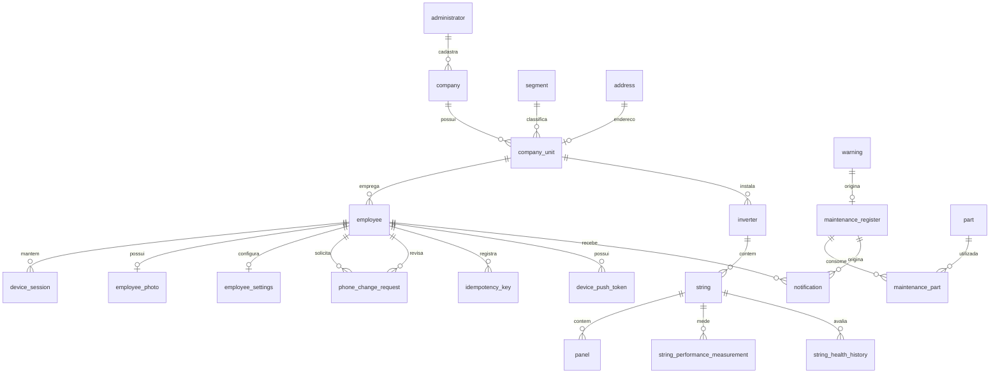

# Modelo de dados e cardinalidades — Apollo 2º ano

Este documento descreve o esquema PostgreSQL entregue em `Script_SQL_Apollo_2ano.sql`. A criação do schema está separada das massas: `Dataload_Apollo_Formal_500_Registros.sql` contém a carga formal volumosa; `Dataload_Apollo_Sujo_160_Registros.sql` contém dados legados inválidos para análise de qualidade em staging. As cardinalidades abaixo decorrem das PKs, FKs, nulidade e unicidade declaradas no script. As tabelas `password_recovery` e `sungrow_credential` e a ampliação de `vw_string_panels` foram incluídas na revisão de 26/10/2026; esses objetos ainda precisam de execução e conferência em PostgreSQL 16.

## Modelo conceitual

- **Organização:** administrador cadastra empresas, filiais e gerentes; cada filial pertence a uma empresa e a um segmento e possui um endereço próprio.
- **Operação solar:** uma filial instala inversores; cada inversor contém strings; cada string contém painéis e recebe medições e cálculos de saúde.
- **Manutenção:** alertas nascem de strings ou painéis; um alerta pode originar no máximo uma ordem de serviço. Ordens podem consumir várias peças e se relacionar como ordem pai/filha.
- **Integração e autenticação:** chaves de idempotência impedem o processamento repetido; `password_recovery` guarda o código e o token de redefinição como hashes e o destino mascarado; `employee_id` pode ser nulo para não revelar se o e-mail está cadastrado. As tabelas `device_session`, `employee_photo`, `employee_settings` e `phone_change_request` dão suporte a sessões, foto, preferências e alteração de telefone no app; cada registro pertence a um funcionário. `sungrow_credential` mantém os tokens da integração Sungrow em registro único.
- **Notificações:** cada funcionário pode registrar tokens FCM por dispositivo e receber notificações; ao abrir uma OS, o banco cria uma notificação para o técnico responsável.
- **Governança e transporte:** `staging` recebe lotes do legado; `audit` guarda versões anterior/posterior de mudanças; `governance` cataloga colunas e procedimentos operacionais; `dm` contém views dimensionais.

As relações N:N materializadas são `maintenance_register ↔ part` por `maintenance_part` e `company_unit ↔ part` por `stock`; as duas tabelas de junção possuem PK composta. O alvo de `warning` é **ou** uma string **ou** um painel (`ck_warning_target`). Para `employee`, `registered_by` e `created_by` são opcionais isoladamente, mas `ck_employee_origin` exige o vínculo correspondente à origem do funcionário.

`employee.is_first_access` é um atributo booleano obrigatório com padrão `true`. A view `vw_auth_user` o expõe para o fluxo de autenticação; a aplicação deve alterá-lo para `false` após o primeiro acesso concluído. A sincronização do RPA preserva o valor em reexecuções. `employee.fcm_token` mantém compatibilidade com integrações que armazenam um único token, enquanto `device_push_token` é o modelo normalizado para múltiplos dispositivos.

`address.is_active` permite desativar endereços sem apagar o histórico. Em `idempotency_key`, `(employee_id, idem_key)` é único e `expires_at` delimita a retenção. Em `notification`, `(maintenance_register_id, employee_id, type)` evita duplicidade em retries; a FK da OS é opcional e usa `ON DELETE SET NULL` para preservar a notificação. O trigger `trg_notify_service_order_opened` cria a notificação de abertura para o técnico.

## Normalização

No núcleo operacional, empresa, filial, endereço, segmento, cargo, modelos, equipamentos, medições, alertas e ordens possuem tabelas próprias. Relações N:N ficam em tabelas de junção; atributos de modelo não se repetem em cada equipamento e a filial não replica os dados do endereço. Esses fatos sustentam o desenho em 3FN para as entidades operacionais. `staging` é intencionalmente uma área de transporte desnormalizada e `dm` é uma camada analítica em views, não parte do modelo transacional em 3FN. Valores históricos como `maintenance_part.unit_cost` são fotografias do custo no momento do consumo.

## Chaves primárias

| Tabela | PK |
| --- | --- |
| `audit.audit_maintenance_register` | `(id)` |
| `audit.audit_panel` | `(id)` |
| `governance.data_catalog` | `(id)` |
| `governance.operational_runbook` | `(id)` |
| `public.access_log` | `(id)` |
| `public.address` | `(id)` |
| `public.administrator` | `(id)` |
| `public.company` | `(id)` |
| `public.company_unit` | `(id)` |
| `public.device_push_token` | `(id)` |
| `public.device_session` | `(id)` |
| `public.employee_photo` | `(employee_id)` |
| `public.employee_settings` | `(employee_id)` |
| `public.employee` | `(id)` |
| `public.idempotency_key` | `(id)` |
| `public.inverter` | `(id)` |
| `public.inverter_model` | `(id)` |
| `public.maintenance_part` | `(maintenance_id, part_id)` |
| `public.maintenance_register` | `(id)` |
| `public.maintenance_type` | `(id)` |
| `public.notification` | `(id)` |
| `public.panel` | `(id)` |
| `public.panel_model` | `(id)` |
| `public.panel_status_history` | `(id)` |
| `public.password_recovery` | `(id)` |
| `public.phone_change_request` | `(id)` |
| `public.part` | `(id)` |
| `public.roles` | `(id)` |
| `public.segment` | `(id)` |
| `public.stock` | `(company_unit_id, part_id)` |
| `public.sungrow_credential` | `(id)` |
| `public.string` | `(id)` |
| `public.string_health_history` | `(id)` |
| `public.string_performance_measurement` | `(id)` |
| `public.suggested_external_relocation` | `(id)` |
| `public.suggested_internal_relocation` | `(id)` |
| `public.warning` | `(id)` |
| `staging.legacy_company` | `(id)` |
| `staging.legacy_company_unit` | `(id)` |
| `staging.legacy_user` | `(id)` |
| `staging.rpa_load_batch` | `(id)` |
| `staging.rpa_load_error` | `(id)` |

## Chaves estrangeiras e cardinalidades

Na coluna “relação”, `1:N` significa que um registro pai pode ter vários filhos; `1:0..1` indica FK única, com no máximo um filho. “Obrigatória” descreve a FK no filho: uma FK opcional permite ausência do pai naquele registro. O banco não exige que todo pai tenha filhos.

| Filho e FK | Pai e chave | Relação | FK no filho |
| --- | --- | --- | --- |
| `public.access_log.employee_id` (`fk_access_employee`) | `public.employee.id` | 1:N | Opcional |
| `public.company.registered_by` (`fk_company_registered_by`) | `public.administrator.id` | 1:N | Obrigatória |
| `public.company_unit.address_id` (`fk_unit_address`) | `public.address.id` | 1:0..1 | Obrigatória |
| `public.company_unit.company_id` (`fk_unit_company`) | `public.company.id` | 1:N | Obrigatória |
| `public.company_unit.registered_by` (`fk_unit_registered_by`) | `public.administrator.id` | 1:N | Obrigatória |
| `public.company_unit.responsible_employee_id` (`fk_unit_responsible_employee`) | `public.employee.id` | 1:N | Opcional |
| `public.company_unit.segment_id` (`fk_unit_segment`) | `public.segment.id` | 1:N | Obrigatória |
| `public.device_push_token.employee_id` (`fk_push_token_employee`) | `public.employee.id` | 1:N | Obrigatória |
| `public.device_session.employee_id` (`device_session_employee_id_fkey`) | `public.employee.id` | 1:N | Obrigatória; sessões removidas com o funcionário |
| `public.employee_photo.employee_id` (`employee_photo_employee_id_fkey`) | `public.employee.id` | 1:0..1 | Obrigatória; foto removida com o funcionário |
| `public.employee_settings.employee_id` (`employee_settings_employee_id_fkey`) | `public.employee.id` | 1:0..1 | Obrigatória; preferências removidas com o funcionário |
| `public.phone_change_request.employee_id` (`phone_change_request_employee_id_fkey`) | `public.employee.id` | 1:N | Obrigatória; solicitações removidas com o funcionário |
| `public.phone_change_request.reviewed_by` (`phone_change_request_reviewed_by_fkey`) | `public.employee.id` | 1:N | Opcional; funcionário revisor não é removido se houver solicitação |
| `public.employee.company_unit_id` (`fk_employee_company_unit`) | `public.company_unit.id` | 1:N | Obrigatória |
| `public.employee.created_by` (`fk_employee_created_by`) | `public.employee.id` | 1:N | Opcional |
| `public.employee.registered_by` (`fk_employee_registered_by`) | `public.administrator.id` | 1:N | Opcional |
| `public.employee.role_id` (`fk_employee_role`) | `public.roles.id` | 1:N | Obrigatória |
| `public.idempotency_key.employee_id` (`fk_idempotency_employee`) | `public.employee.id` | 1:N | Obrigatória |
| `public.inverter.created_by` (`fk_inverter_created_by`) | `public.employee.id` | 1:N | Obrigatória |
| `public.inverter.inverter_model_id` (`fk_inverter_model`) | `public.inverter_model.id` | 1:N | Obrigatória |
| `public.inverter.company_unit_id` (`fk_inverter_unit`) | `public.company_unit.id` | 1:N | Obrigatória |
| `public.maintenance_part.maintenance_id` (`fk_mpart_maintenance`) | `public.maintenance_register.id` | 1:N | Obrigatória |
| `public.maintenance_part.part_id` (`fk_mpart_part`) | `public.part.id` | 1:N | Obrigatória |
| `public.maintenance_register.cancelled_by` (`fk_maintenance_cancelled_by`) | `public.employee.id` | 1:N | Opcional |
| `public.maintenance_register.created_by` (`fk_maintenance_created_by`) | `public.employee.id` | 1:N | Obrigatória |
| `public.maintenance_register.parent_maintenance_id` (`fk_maintenance_parent`) | `public.maintenance_register.id` | 1:N | Opcional |
| `public.maintenance_register.technician_id` (`fk_maintenance_technician`) | `public.employee.id` | 1:N | Obrigatória |
| `public.maintenance_register.maintenance_type_id` (`fk_maintenance_type`) | `public.maintenance_type.id` | 1:N | Obrigatória |
| `public.maintenance_register.warning_id` (`fk_maintenance_warning`) | `public.warning.id` | 1:0..1 | Obrigatória |
| `public.notification.employee_id` (`fk_notification_employee`) | `public.employee.id` | 1:N | Obrigatória |
| `public.notification.maintenance_register_id` (`fk_notification_register`) | `public.maintenance_register.id` | 1:N | Opcional |
| `public.password_recovery.employee_id` (`fk_password_recovery_employee`) | `public.employee.id` | 1:N | Opcional |
| `public.panel.string_id` (`fk_panel_string`) | `public.string.id` | 1:N | Obrigatória |
| `public.panel_status_history.panel_id` (`fk_history_panel`) | `public.panel.id` | 1:N | Obrigatória |
| `public.stock.part_id` (`fk_stock_part`) | `public.part.id` | 1:N | Obrigatória |
| `public.stock.company_unit_id` (`fk_stock_unit`) | `public.company_unit.id` | 1:N | Obrigatória |
| `public.string.created_by` (`fk_string_created_by`) | `public.employee.id` | 1:N | Obrigatória |
| `public.string.inverter_id` (`fk_string_inverter`) | `public.inverter.id` | 1:N | Obrigatória |
| `public.string.panel_model_id` (`fk_string_panel_model`) | `public.panel_model.id` | 1:N | Obrigatória |
| `public.string_health_history.string_id` (`fk_health_history_string`) | `public.string.id` | 1:N | Obrigatória |
| `public.string_performance_measurement.string_id` (`fk_measurement_string`) | `public.string.id` | 1:N | Obrigatória |
| `public.suggested_external_relocation.destination_company_id` (`fk_external_destination_company`) | `public.company.id` | 1:N | Obrigatória |
| `public.suggested_external_relocation.panel_id` (`fk_external_panel`) | `public.panel.id` | 1:N | Obrigatória |
| `public.suggested_external_relocation.requested_by` (`fk_external_requested_by`) | `public.employee.id` | 1:N | Obrigatória |
| `public.suggested_external_relocation.reviewed_by` (`fk_external_reviewed_by`) | `public.employee.id` | 1:N | Opcional |
| `public.suggested_external_relocation.segment_id` (`fk_external_segment`) | `public.segment.id` | 1:N | Obrigatória |
| `public.suggested_internal_relocation.suggested_unit_id` (`fk_internal_destination_unit`) | `public.company_unit.id` | 1:N | Obrigatória |
| `public.suggested_internal_relocation.requested_by` (`fk_internal_requested_by`) | `public.employee.id` | 1:N | Obrigatória |
| `public.suggested_internal_relocation.reviewed_by` (`fk_internal_reviewed_by`) | `public.employee.id` | 1:N | Opcional |
| `public.suggested_internal_relocation.string_id` (`fk_internal_string`) | `public.string.id` | 1:N | Obrigatória |
| `public.warning.panel_id` (`fk_warning_panel`) | `public.panel.id` | 1:N | Opcional |
| `public.warning.reported_by` (`fk_warning_reported_by`) | `public.employee.id` | 1:N | Opcional |
| `public.warning.string_id` (`fk_warning_string`) | `public.string.id` | 1:N | Opcional |
| `staging.legacy_company.load_batch_id` (`fk_legacy_company_batch`) | `staging.rpa_load_batch.id` | 1:N | Obrigatória |
| `staging.legacy_company_unit.load_batch_id` (`fk_legacy_unit_batch`) | `staging.rpa_load_batch.id` | 1:N | Obrigatória |
| `staging.legacy_user.load_batch_id` (`fk_legacy_user_batch`) | `staging.rpa_load_batch.id` | 1:N | Obrigatória |
| `staging.rpa_load_error.load_batch_id` (`fk_rpa_error_batch`) | `staging.rpa_load_batch.id` | 1:N | Obrigatória |

As tabelas `audit.*` e `governance.*` não têm FKs: os registros de auditoria e metadados continuam legíveis mesmo após mudanças nas entidades operacionais. As cinco tabelas `staging.*` possuem suas PKs; quatro delas referenciam o lote em `staging.rpa_load_batch`.

## Camada dimensional

As cinco views adicionadas em 12/10/2026 são `dm.dim_maintenance_type`, `dm.dim_part`, `dm.fact_warning`, `dm.fact_relocation` e `dm.fact_stock`. A chave lógica de realocação é `(relocation_scope, relocation_key)`. `public.vw_string_panels` expõe dados do painel, modelo, capacidade da string, saúde e alertas ativos; ela não altera cardinalidades do modelo transacional.

As views `dm.dim_*` apresentam dimensões de empresa, filial, segmento, equipamentos, funcionário e data; as views `dm.fact_*` apresentam desempenho, saúde, manutenção, consumo e DAU. Essa organização é um snowflake lógico por views sobre o modelo transacional. `dm.fact_string_daily_performance` e `dm.fact_maintenance` usam CTEs e window functions para totais acumulados, médias móveis e rankings. `dm.vw_maintenance_chain` usa CTE recursiva para percorrer ordens ligadas por `parent_maintenance_id`.
